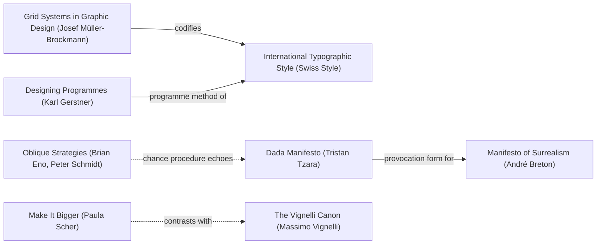
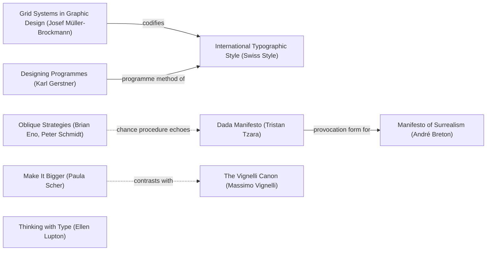

# DESIGN-LOG: Esoteric Languages (esoteric-languages.shadw.app)

## Traversal Plan

**Brief, restated:** a bold, multi-page static site that explains esoteric programming languages (Brainfuck, Ook!, Befunge, Whitespace, Piet, Malbolge, LOLCODE and others, with Scratch as a non-esoteric control) to a curious public, built in the empty repo `SolutionsAsService/esoteric-languages`, deploy-ready for Vercel and Shadw.

**Mode: Adaptive.** The site serves a public of programmers and the curious, so it must be advanced and still approachable. Governing criterion: MAYA (Loewy).
**Run type: Full** (new work, nothing exists), with the Landing workflow inside it as the landing move. R0 premortem: not required (no artifact exists; the repo has no commits).

**Read before Step 1:** `dada-lessons/GRADES.md` and lessons 40–42 and 57. A landing is graded A when it is one composed poster of the whole site, each tile carrying a computed figure, complete on the first screen; B when it shows one topic or is cut off; and the hero should be the product's own worked example.

### Step 0: Tooling inventory
| Job | Tool used |
|---|---|
| Render the anchor graph | none available (no Mermaid renderer in the tool list); Mermaid text below |
| Compute the Frontier | by hand from the edge lines of `references/anchor-graph.md` (grep) |
| Track workflow state | the app's task list (`update_plan`) plus the Frontier table here |
| Run the panel | the Agent tool, one agent per literary reference, at most three at a time, each filing to `_src/design/panel/R<n>/<seat>.md` |
| Collect panel reports | `scripts/collect_panel.py` from the dada skill |
| Measure the artifact | the in-app browser (Claude Browser) with a JavaScript probe (`_src/design/measure.js`), at 1280 x 800 and 375 x 812 |
| Persist the log | this file |
| Engines | `_src/eso/*.py`: interpreters written for this site; the build runs every program and fails on drift |

### Inventory (Landing step 1): every page and the figure that stands for it
| Page | Figure for its tile (computed by the build) | Glyph |
|---|---|---|
| Brainfuck | steps to print its greeting | the 106-character program |
| Ook! | steps (the same machine as Brainfuck) | the program's Ook words |
| Befunge-93 | steps, and how the 21 cells are revisited | the program's grid and the instruction pointer's path |
| Whitespace | steps | the invisible program made visible (space and tab as bars) |
| Piet | steps (colour-block transitions) | the program itself, an image |
| Malbolge | steps | the program text |
| LOLCODE | steps | the program text |
| Scratch (control: visual, not esoteric) | blocks in the program | the two blocks, drawn |
| More languages (INTERCAL, Shakespeare, Chef, …) | a link from the poster | — |
| About (what makes a language esoteric; how this site runs them; sources) | linked from the poster and the footer | — |

### Seed (labels copied verbatim from the anchor graph)
- **Stance:** `Make It Bigger (Paula Scher)`
- **Rules:** `Grid Systems in Graphic Design (Josef Müller-Brockmann)` --codifies--> `International Typographic Style (Swiss Style)` <--programme method of-- `Designing Programmes (Karl Gerstner)`
- **Breaker:** `Dada Manifesto (Tristan Tzara)`
- **Counterpoint (dotted):** `Oblique Strategies (Brian Eno, Peter Schmidt)` -.chance procedure echoes.-> `Dada Manifesto (Tristan Tzara)`
- **Second dotted edge leaving a seed node (S5):** `Make It Bigger (Paula Scher)` -.contrasts with.-> `The Vignelli Canon (Massimo Vignelli)`

Chain: Make It Bigger (Paula Scher) → (scale as the argument) → Grid Systems in Graphic Design (Josef Müller-Brockmann) --codifies--> International Typographic Style (Swiss Style) <--programme method of-- Designing Programmes (Karl Gerstner); the grid is broken by Dada Manifesto (Tristan Tzara), whose counterpoint Oblique Strategies (Brian Eno, Peter Schmidt) arrives by the dotted edge "chance procedure echoes".

**Why these.** Piet is named after Piet Mondrian, so the site's grid can be Mondrian's: heavy black bars, primary fields (Müller-Brockmann's grid, made visible). Gerstner's *programme*: the palette is not chosen but taken from the Piet specification (18 hues by lightness, plus black and white), and each language gets one field. Tzara: esoteric languages are Dada practised on programming; nonsense as a working system. The poster is a collage of eight programs whose text *is* the image. Scher: make the numbers and the programs bigger than the words about them.

### Initial Frontier
| Candidate | Reached via (edge label, direction) | From anchor | Status |
|---|---|---|---|
| Mondrian grid: black bars, Piet fields | codifies (out) | Grid Systems in Graphic Design (Josef Müller-Brockmann) | OPEN |
| Piet palette as the token set; one hue per language | programme method of (in) | Designing Programmes (Karl Gerstner) | OPEN |
| Display scale: names, figures and programs larger than prose | stance | Make It Bigger (Paula Scher) | OPEN |
| Landing poster: eight programs as collage, code as image | breaker | Dada Manifesto (Tristan Tzara) | OPEN |
| Honour the variance: print each program's real output, unnormalised | chance procedure echoes (dotted, in) | Oblique Strategies (Brian Eno, Peter Schmidt) | OPEN |
| Restraint on inner pages: one family, strict system | contrasts with (dotted, out) | The Vignelli Canon (Massimo Vignelli) | OPEN |
| Build guarantees: every program run, every figure computed | field note 4 | (workflow) | OPEN |
| Provocation form continues into Surrealism | provocation form for (out) | Dada Manifesto (Tristan Tzara) | OPEN |

### Graph (visited marked)

### Panel (Adaptive: Provocateur and Inclusion required, plus at least three chosen for difference)
One agent per literary reference: Debord, Shklovsky (Provocateur); Holmes, Mace (Inclusion); Cairo (Evidence, the measurement seat); Krug (Usability); Arnheim (Formalist, for the poster's visual force); Fletcher (Wit, because the subject is jokes that work). Dotted pair: Krug ↔ Debord.

### First moves
M1 KEEP-THE-RULE (grid + palette programme), M2 KEEP-THE-RULE (type at Scher scale), M3 BREAK (the poster collage), M4 KEEP-THE-RULE (build guarantees), M5 KEEP-THE-RULE (counterpoint: real outputs, unnormalised), M6 KEEP-THE-RULE (Vignelli restraint on inner pages).

## Decision Records

## Move M1: The Mondrian grid, coloured by the Piet specification  (KEEP-THE-RULE)
Depends on: none
Anchors: Rule Grid Systems in Graphic Design (Josef Müller-Brockmann) | Rule Designing Programmes (Karl Gerstner) | Rule International Typographic Style (Swiss Style)
Intent: every page sits on a 12-column grid whose gutters are drawn as heavy black bars; fields are filled with colours taken from the Piet specification (6 hues x 3 lightnesses, black, white). Each language owns one field colour, used for its poster tile and its page band.
Formal argument: the grid is the order that makes the break legible (Müller-Brockmann); a programme chooses the palette so no colour is arbitrary (Gerstner): Piet is named after Mondrian, and Mondrian's black bars are a grid made visible.
Alternatives rejected: (1) a neutral dark "hacker" theme: the cliché of the subject, says nothing about it; (2) a different random hue per page: arbitrary, nothing to learn.
Consequence: saturated fields need contrast checks per ink (blue and dark red take white ink).
Fence: n/a.
Frontier effect: opens contrast per field; the poster form (M3).
Mode field: Advanced pole (Gerstner): a palette derived from a programming language's spec. Acceptable pole (Müller-Brockmann): a strict grid that reads instantly.

## Move M2: Make the programs and numbers bigger than the words  (KEEP-THE-RULE)
Depends on: M1
Anchors: Stance Make It Bigger (Paula Scher) | Rule International Typographic Style (Swiss Style)
Intent: Archivo (heavy, condensed and expanded widths) for display and figures; JetBrains Mono for every program; body copy small and plain. Language names and step counts are set at poster scale; programs are shown whole, never as screenshots.
Formal argument: Scher: scale is the argument; the subject is programs, so the programs are the largest objects on the page.
Alternatives rejected: (1) a pixel or terminal font for everything: costume, hurts reading; (2) one weight throughout: no hierarchy.
Consequence: two web fonts; long programs (Ook!, 1,059 characters) need a texture treatment, not full legibility, on the poster, and full text on their page.
Fence: n/a.
Frontier effect: smallest-label check at 375 px (lesson 50).
Mode field: Advanced: code as display type. Acceptable: prose stays at reading size and measure.

## Move M3: The poster: eight programs, one sentence  (BREAK)
Depends on: M1, M2, M4
Anchors: Breaker Dada Manifesto (Tristan Tzara) | Stance Make It Bigger (Paula Scher) | Rule Grid Systems in Graphic Design (Josef Müller-Brockmann)
Intent: the landing's first screen is one composed poster: eight fields on the black-bar grid, one per language page, each showing that language's real "Hello, World!" program as its image (Brainfuck's symbols, Ook!'s words, Befunge's grid with the pointer's path, Whitespace made visible, the Piet program itself, Malbolge's text, LOLCODE's lines, Scratch's two blocks), the language name, and one big computed figure: the steps it took to say hello. Every field links to its page. Complete at 1280 x 800 and 375 x 812.
Formal argument: Tzara: meaning from apparent nonsense; eight unreadable texts that all say the same sentence is the subject in one image. Lessons 41–42 and 57: the hero summarises the whole site and is the product's own worked example.
Alternatives rejected: (1) a single giant Brainfuck program: one topic, graded B before (lesson 41); (2) a table of languages: no image; (3) an animated interpreter: motion before meaning, and a reduced-motion cost.
Consequence: eight dense textures in one view; the grid must hold them; the phone needs a 2 x 4 version that still fits.
Fence: the grid exists so the eye can find things; the break is in the content of the fields, not in their order.
Frontier effect: measure first-screen bottom edge at both sizes; five-second test; S4 push of this move.
Mode field: Advanced: code as collage. Acceptable: every field names its language and links to a page that explains it.

## Move M4: Run everything; print only what the build computed  (KEEP-THE-RULE)
Depends on: none
Anchors: Rule Designing Programmes (Karl Gerstner) | field note 4 ("put the guarantees in the build")
Intent: `_src/build.py` runs every program through the interpreters in `_src/eso/`, fails if an output or a step count changes from what a page says, writes the program files the site offers for download, generates the Piet program and checks it by running the PNG back in, and fails on any broken internal link. Facts (creator, year) live in `_src/data/languages.json`, each with a source URL.
Formal argument: a site about programs that do strange things must show they do them; a figure a reader can reproduce is the only honest kind.
Alternatives rejected: (1) copy outputs from the web: unverifiable; (2) embed an online interpreter: a dependency and no build-time check.
Consequence: interpreters to maintain; INTERCAL, Shakespeare and Chef are not run, so they live on "More" and say so.
Fence: n/a.
Frontier effect: Step 2g's figure table is generated, not handwritten.
Mode field: Acceptable: trust.

## Move M5: Honour the variance  (KEEP-THE-RULE; counterpoint)
Depends on: M3, M4
Anchors: Counterpoint Oblique Strategies (Brian Eno, Peter Schmidt) (dotted edge "chance procedure echoes" to Dada Manifesto (Tristan Tzara))
Intent: each field prints what its program actually printed, unnormalised: Brainfuck's "Hello World!" with a newline, Malbolge's "Hello World!" with no comma, the rest "Hello, World!". The differences stay visible.
Formal argument: "Honour thy error as a hidden intention" (Eno and Schmidt); normalising would be a lie told for neatness.
Alternatives rejected: (1) rewrite programs so all print the same string: hides that these programs are found, not written (Malbolge's especially); (2) hide the output line: loses the proof.
Consequence: the poster's repeated sentence is not quite repeated; the caption says why.
Fence: n/a.
Frontier effect: none.
Mode field: Advanced: the irregularity is the content.

## Move M6: Restraint on inner pages  (KEEP-THE-RULE; dotted edge from the Stance)
Depends on: M1, M2
Anchors: Stance Make It Bigger (Paula Scher) -.contrasts with.-> The Vignelli Canon (Massimo Vignelli)
Intent: the break lives on the home page; every inner page uses one strict template: a band in the language's field colour with its name and program, then the same sections in the same order (What it is, The instructions, Hello, World!, How it runs, Sources), shared navigation, one type system.
Formal argument: field note 1: resolve strangeness against recognition by address; Vignelli's discipline makes eight different languages comparable.
Alternatives rejected: (1) a different layout per language: the reader relearns each page; (2) poster-scale chaos on every page: memorable nowhere.
Consequence: language-specific visuals (Befunge path, Piet blocks) must fit one section slot.
Fence: n/a.
Frontier effect: none.
Mode field: Acceptable pole.

### Render notes for M1–M6 (measured, before R1)
- M3, first render: the Whitespace glyph (one bar row per program line) drew 14 short rows at about 60 px wide, too small to read. Changed to the program as one wrapped stream, 24 characters a row: the glyph now fills its field. The Piet program began at light lightness and read as pastel; generating from normal lightness makes its big blocks saturated Piet colours, and the build re-ran it (still 26 steps, still "Hello, World!"). SVG glyphs were cropped at the top by the field; `height: 100%` with `xMinYMax meet` now scales each whole program into its field.
- M3: code textures longer than their field were cut mid-line at the top; a 1.6em top fade marks them as continuing.
- First screen rule (lesson 40): poster bottom 800 at 1280 x 800 and 812 at 375 x 812, both complete; the probe's control (hero forced to 1400 px) reports bottom 1464, incomplete, so the check can fail.

## Panel Reports

### Panel, WHOLE, round R1  (artifact examined: site/ after M1–M6; evidence `_src/design/panel/R1/evidence.md`; shots `_src/design/shots/R1/`)
Eight seats, one agent per reference, at most three at a time; `collect_panel.py`: 8 of 8 reported.

| Critic | Anchor used | Observed in the work | Verdict | Requested change |
|---|---|---|---|---|
| Critic: Provocateur (Debord) | The Society of the Spectacle, §1, §4 | home lead says "Each field is a real program … run by this site", and the meta/JSON-LD says every program shown is run, but Scratch is drawn, not run; "906 steps … LOLCODE needs 1" invites comparison and the caveat lives only on About | OBJECT | say seven of eight are run; caveat the comparison where it is made |
| Critic: Evidence (Cairo) | How Charts Lie | reran the build and all 7 programs: every figure reproduces; step definitions on About match the code; but the units differ (one BF command vs one LOLCODE statement) and the poster sets them as one number with no caveat on the first screen; About's sentence half-contradicts itself; BF/Ook print 12 characters, the rest 13 | OBJECT | one sentence on the poster: the counts are not a ranking; fix About |
| Critic: Formalist (Arnheim) | Art and Visual Perception: weight, balance, skeleton | asymmetric balance holds (red and black masses left, white and blue right); the numerals carry the force, the programs sit as ground; the Piet image stops about 360 px into its field, leaving dead black | PASS | let the Piet image fill its field |
| Critic: Usability (Krug) | Don't Make Me Think: five-second and trunk tests | five-second test passes (site name, 3+ topics, meaning of numbers); trunk test passes on befunge.html; nothing says the fields are clickable; "Index" for home | PASS | add a click cue; "Home" |
| Critic: Inclusion (Holmes) | Mismatch: solve for one, extend to many | the Piet picture's text alternative covers 6 of 26 transitions; "stack" and "pointer" are not defined on piet.html or whitespace.html | OBJECT | define the terms in place; publish all 26 transitions as text |
| Critic: Inclusion (Mace) | Principles of Universal Design 2–5; focus check | every focus ring checked against its surface in both schemes; regions focusable; reduced motion respected; Whitespace glyph's black vs red bars differ by hue only (decorative, explained in prose) | PASS | non-blocking: make the Whitespace bars differ by more than hue |
| Critic: Provocateur (Shklovsky) | Art as Technique: automatization | the Mondrian reference is expected; programs-as-images estrange only in Whitespace, Piet and Befunge; the Brainfuck, Ook!, Malbolge and LOLCODE fields are monospaced text on a flat colour, "a code screenshot"; the inner template automatizes by the third page | PASS | let each language's strangeness change the form |
| Critic: Wit (Fletcher) | The Art of Looking Sideways | the poster is a true pun (Piet/Mondrian; a program as a painting, a chart, a wall of apes, a blank page); the copy explains jokes the image already made; 906/906 is a gag the screen never lets the reader find | PASS | cut the Discworld explanation to a clause; caption the Ook! field |

Statements of meaning: real, reproducible Hello Worlds, tidier in the headline than in the footnotes (Debord); honest counts that are not a league table (Cairo); one frame, eight weights (Arnheim); the site shows each language as the thing it pretends to be (Fletcher); code made visible only where the language hides it (Shklovsky).
Artist questions: none put to the panel this round.
Critic questions: why is the non-comparable number the loudest thing (Debord)? what false belief does "LOLCODE 1, Brainfuck 906" leave (Cairo)? could a reader reconstruct Piet without the picture (Holmes)? where does a visitor find the joke without being told (Fletcher)? would the fields still estrange without the bars (Shklovsky)?
Andon pulled: no.
**Disagreement to resolve:** Fletcher wants less explanation on the first screen; Debord, Cairo and Krug each want one more sentence or cue there. Resolved in M7: the caveat in one short sentence, the click cue in the graphic (an arrow), not in prose.

**Premises tested before spending moves:** Debord: the lead and the meta claim "run by this site" for all eight, and Scratch is not run (grep) — holds. Cairo: the units differ by construction (`_src/eso/langs.py`) — holds. Holmes: no definition of "stack" on piet.html or whitespace.html, and "first six" in the Piet trace (grep) — holds.

## Move M7: Say exactly what was run, and what the numbers are not  (KEEP-THE-RULE; resolves Debord, Cairo; answers Krug, Fletcher)
Depends on: M3, M4
Anchors: The Society of the Spectacle (Debord) | How Charts Lie (Cairo) | Don't Make Me Think (Krug) | The Art of Looking Sideways (Alan Fletcher)
Intent: the hero sentence says seven programs were run and Scratch is drawn, and that a step means something different in each language, so the numbers are costs, not a ranking. Each field name gets an arrow as the click cue. The Ook! field carries a caption: "the Brainfuck program, in orangutan". Meta description, JSON-LD and footer say seven of eight. The home "906 … 1" sentence links the caveat. About says plainly the counts are not comparable. Nav "Index" becomes "Home". The Ook! page's Discworld sentence shrinks to a clause.
Formal argument: Debord: a claim the site itself contradicts is spectacle; Cairo: a comparison must be caveated where it is shown; Krug: the affordance must be visible; Fletcher: the caveat goes in one sentence and the cue in the graphic, so the image is not explained to death.
Alternatives rejected: (1) remove the step counts from the poster: removes the computed figure that earned the A in lesson 42; (2) normalise steps to a common unit: there is none across a tape machine, a grid, an image and a statement language.
Consequence: one more line of small type on the first screen; the poster bottom must be re-measured.
Fence: n/a. Frontier effect: re-measure first screen. Mode field: Acceptable pole.

## Move M8: Explain the machine where it is used  (KEEP-THE-RULE; resolves Holmes)
Depends on: M6
Anchors: Mismatch: How Inclusion Shapes Design (Kat Holmes)
Intent: piet.html and whitespace.html each define "stack" at first use, and Piet defines its direction pointer. piet.html publishes all 26 transitions as a text table inside a `
` element after the first six.
Formal argument: a reader who arrives from search on one page must not need another page to follow it (solve for one, the deep-linked reader; it extends to screen-reader users, for whom the table stands in for the picture).
Alternatives rejected: (1) a glossary page: the reader still leaves the page; (2) a long `alt` description: tables are navigable, prose is not.
Consequence: piet.html grows by one collapsed table.
Fence: n/a. Frontier effect: none. Mode field: Acceptable pole.

## Move M9: Let Piet fill its field; make Whitespace legible without hue  (KEEP-THE-RULE; Arnheim, Mace)
Depends on: M3
Anchors: Art and Visual Perception (Rudolf Arnheim) | The Principles of Universal Design (Ronald Mace et al.)
Intent: generate the Piet program 20 codels tall (aspect 3.67, against the field's 3.3) so it fills the field's width; the build re-runs it (measured: still 26 steps, still "Hello, World!"). Whitespace bars: spaces outlined, tabs solid, line feeds solid red and taller, so the three differ by shape as well as hue.
Formal argument: Arnheim: a mass that stops short leaves the field's centre of gravity off its axis; Mace, principle 4: redundant encoding.
Alternatives rejected: (1) stretch the image to non-square codels: misrepresents the program; (2) crop it: hides part of the program.
Consequence: the Piet program on its page changes shape; its step count must not.
Fence: n/a. Frontier effect: none. Mode field: Advanced pole: the program as the field's full image.

## Move M10: Every field shows its language's strangeness, not just its text  (BREAK; S4 ambition push of M3)
Depends on: M3, M5
Anchors: Breaker Dada Manifesto (Tristan Tzara) | Art as Technique (Viktor Shklovsky) | Stance Make It Bigger (Paula Scher)
Intent: the four fields Shklovsky called code screenshots each get the device their language is about. Brainfuck: the program above the tape it leaves behind (the bytes it built, computed by running it). Malbolge: the program as written above the same cells after running, scrambled by its own execution, changed characters marked (computed). LOLCODE: set as a lolcat caption (heavy capitals, white with a black outline), the joke the language is named for. Ook!: the caption from M7. Malbolge's page shows the before and after in "How it runs".
Formal argument: S4 asks for the seeded Breaker pushed harder; Tzara's collage becomes eight different kinds of image, each true to its language; Shklovsky: the device must make the reader see what is strange, not just read text.
Alternatives rejected: (1) animate each program running: motion cost, and it shows the interpreter, not the language; (2) illustrations: decoration, not the program.
Consequence: more drawing in the fields; the phone fields (47 px of glyph) must still hold them.
Fence: the grid stays; only field contents change.
Frontier effect: re-measure the first screen; count fields whose glyph is plain program text (before: 4; target 0, by class).
Mode field: Advanced: eight devices. Acceptable: the caption and each page explain them.
Residual diff (to verify at R2): first-screen bottom at both sizes, contrast, overflow.

**Declined (recorded):** Shklovsky's request to give "How it runs" a different form on every inner page. M6 (Vignelli) keeps one template so eight languages stay comparable; the sections already differ in content (tape, histogram, decoded listing, colour table, mutation table, loop), and Malbolge gains its before and after (M10). Frontier: DEFERRED with this reason.

### Render notes for M7–M10 (measured)
- M7: at 375 x 812 the first, three-sentence hero line took five lines and pushed the Ook! and Malbolge devices out of their fields, and LOLCODE's caption was cut at the top. Shortened to one sentence of three clauses; on phones the step figure and its unit share a line; LOLCODE gets the top fade. Re-measured: poster bottom 812/812, all eight devices visible.
- M9: Piet field fill 490 of 490 px (was about 360); program 77 x 21 codels, still 26 steps.
- M10: fields whose glyph is plain program text: 4 → 0 (counted by class). Probe after all four moves: contrast minimum 5.25 light and dark, overflow 0, targets 0, first screen complete at both sizes.

### Panel, WHOLE, round R2  (artifact examined: site/ after M7–M10; evidence `_src/design/panel/R2/evidence.md`; shots `_src/design/shots/R2/`)
Eight seats, one agent per reference, at most three at a time; `collect_panel.py`: 8 of 8 reported.

| Critic | Anchor used | Observed in the work | Verdict | Requested change |
|---|---|---|---|---|
| Critic: Provocateur (Debord) | Society of the Spectacle, theses 1, 4, 9 | R1 resolved in hero, meta, JSON-LD, footer, About; verified 58 of 64 and the tape by running them; "906 is still the loudest figure, but its unit is now stated beside it" | PASS | optional: let Scratch's "2 blocks" differ in kind |
| Critic: Evidence (Cairo) | How Charts Lie | build clean; all 7 programs reproduce; recomputed tape [0,0,72,100,87,33,10,0] and 58 of 64, both match the site; caveat is on the first screen | PASS | none |
| Critic: Inclusion (Holmes) | Mismatch | R1 resolved (stack, heap defined; all 26 transitions as text); every aria-hidden device has a text twin | PASS | optional: phone notes 11 → 12 px |
| Critic: Formalist (Arnheim) | Art and Visual Perception | Piet resolved (bars run to the field's edge); counterweights stable; the white Malbolge marks are the brightest patch in the bottom row and pull the eye below its own "40" | PASS | tint the Malbolge marks so the numeral outranks them |
| Critic: Usability (Krug) | Don't Make Me Think | five-second test passes; arrows read as links; devices sit below the name/number/output stack and do not slow the scan | PASS | set the explanatory sentence one size up |
| Critic: Inclusion (Mace) | Principles of Universal Design 2, 4, 5 | summaries keyboard-reachable, 24 px, focus visible; Whitespace shapes redundant; Malbolge marks are colour-only in the glyph (text twin exists) | PASS | add a non-colour cue (underline) to the Malbolge marks |
| Critic: Provocateur (Shklovsky) | Art as Technique | the devices come from each language's own behaviour; Malbolge strongest; decline accepted; Ook! still text with a caption doing the estranging | PASS | give Ook! a computed device: Ook pairs under the Brainfuck symbols they stand for |
| Critic: Wit (Fletcher) | The Art of Looking Sideways | the 906/906 gag is found; LOLCODE and Malbolge are true visual puns; the Malbolge page's before/after line is cut at the right edge | PASS | show the whole 64-character pair without clipping |

Statements of meaning: a poster whose every number can be reproduced, and which says which one cannot (Debord); eight perceptions, not eight skins on one code box (Shklovsky); number leads, program follows (Arnheim); each language's own gag does the talking (Fletcher).
Critic questions: is a big number still the right way to make a reader feel cost (Debord)? does "40 steps" hide what the steps did to the program (Shklovsky)? should any device be brighter than its own numeral (Arnheim)? does Piet need a joke, or is its silence the contrast (Fletcher)?
Andon pulled: no. **No OBJECT this round.** It is not quiet under S3, because M11 below adopts its requested changes.
Premise tested: Fletcher's clipping holds: the pair is 683 px of content in a 572 px box at 1280 and a 322 px box at 375 (it scrolls).

## Move M11: Close the R2 requests  (KEEP-THE-RULE)
Depends on: M7, M10
Anchors: Art and Visual Perception (Rudolf Arnheim) | The Principles of Universal Design (Ronald Mace et al.) | Art as Technique (Viktor Shklovsky) | The Art of Looking Sideways (Alan Fletcher) | Don't Make Me Think (Steve Krug) | Mismatch (Kat Holmes)
Intent: (1) Malbolge marks: underlined and lightly tinted instead of solid white (Arnheim, Mace). (2) Ook!'s field: the program's first commands as Brainfuck symbols with their Ook pairs set beneath, computed from the program (Shklovsky). (3) Malbolge page: before and after in aligned 16-character chunks that wrap, so all 64 characters show without sideways scroll (Fletcher). (4) The hero sentence one size up (Krug), phone notes and outputs 12 px (Holmes), if the first screen still fits.
Formal argument: each is a measured request from a passing seat; none changes the concept.
Alternatives rejected: (1) leave them as open items: cheap, and two are measurable defects (clipping, a mark brighter than its figure); (2) Debord's optional "2 blocks in a different kind": the label already differs (blocks, "control: not esoteric"); declined, logged.
Consequence: first-screen heights change; re-measure the bottom edge at both sizes.
Fence: n/a. Frontier effect: none. Mode field: Acceptable pole (legibility), Advanced pole (Ook! device).
Residual diff (to verify): poster bottom at both sizes; Malbolge pair scrollWidth = clientWidth; smallest text.

### Render notes for M11 (measured)
- Malbolge pair: scrollWidth = clientWidth (578/578 at 1280, 328/328 at 375); 2 and 3 rows of chunks. Ook! device first measured at 117 px of glyph: the evidence file reported "21 pairs visible whole" — true of 21 pairs, but a third, cut row was also visible. That claim was an instrument error (it counted whole pairs and ignored cut ones); see R3.
- Hero sentence 14–19 px; phone outputs and notes 12 px. Probe: contrast 5.25 light and dark, overflow 0, targets 0, first screen complete at both sizes. The 12 px floor is for readable text; the probe skips aria-hidden glyphs, whose smallest type is 6 px (Ook! pairs on phones) and whose content is given as text on each language page (Holmes R3).

### Panel, WHOLE, round R3  (artifact examined: site/ after M11; evidence `_src/design/panel/R3/evidence.md`; shots `_src/design/shots/R3/`)
Eight seats, one agent per reference, at most three at a time; `collect_panel.py`: 8 of 8 reported.

| Critic | Anchor used | Observed in the work | Verdict | Requested change |
|---|---|---|---|---|
| Critic: Formalist (Arnheim) | Art and Visual Perception: weight, closure | Malbolge marks resolved, the "40" is again the heaviest mass; the Ook! device gives the yellow field a skeleton; its third row is sliced by the field edge ("a form cut by its frame reads as accident") | OBJECT | show only whole rows |
| Critic: Wit (Fletcher) | The Art of Looking Sideways | Malbolge pair whole; Ook! device keeps the joke "and arguably sharper"; third row of pairs sliced | OBJECT | show only whole rows |
| Critic: Provocateur (Shklovsky) | Art as Technique | Ook! device resolved, "the device working, not wallpaper"; other devices computed; third row sliced reads as accident | OBJECT | show only whole rows |
| Critic: Usability (Krug) | Don't Make Me Think | five-second and trunk tests pass; hero sentence readable; notes the cut row | PASS | check the cut row |
| Critic: Inclusion (Holmes) | Mismatch | Ook! and Malbolge devices have text twins; underlines carry the change; the 12 px floor excludes aria-hidden glyphs (6–9 px) | PASS | none (log the floor's scope) |
| Critic: Inclusion (Mace) | Principles of Universal Design 2, 3, 4, 7 | underline cue met; focus rings inset and unclipped; container query trims only whole rows; no two-axis scroll | PASS | none (asks about a fallback without `round()`) |
| Critic: Provocateur (Debord) | Society of the Spectacle, theses 1, 18 | ran the build: Ook! device is the program's 106 commands in order; Malbolge "after" matches the interpreter's memory; "seven of eight" counts correctly | PASS | none |
| Critic: Evidence (Cairo) | How Charts Lie | all figures recompute (906…1; 64 chars, 58 changed; 77 × 21 codels; 26 transitions; tape; 106 pairs); the evidence file's "21 pairs visible whole" is stale and not reproducible without a browser | PASS | re-measure or drop the stale figure |

Statements of meaning: the same program in two costumes, the costume stitched visibly to the body (Fletcher); one program spelled twice (Shklovsky); the site shows the program and what the machine left of it, and says which is which (Debord).
Critic questions: two whole rows or three with one cut (Fletcher, Arnheim)? does a browser without `round()` collapse the field (Mace)? should the Ook! field say it shows the first pairs of 106 (Cairo)?
Andon pulled: no.
**Three seats objected to the same element.** The workflow calls for a frame swap when three critics object to the same move. All three praised the device itself and objected only to its cropping, a measured rendering defect, so this was resolved as ADAPT (M12), not as a frame swap; recorded as a deviation in the Compliance Check.
**Premise tested:** confirmed by measurement before the fix: a row was visibly cut; the probe's "whole pairs" count had not looked for cut ones.

## Move M12: Whole rows only  (ADAPT of M11, resolves Arnheim, Fletcher, Shklovsky; answers Krug, Mace, Cairo)
Depends on: M11
Anchors: Art and Visual Perception (Rudolf Arnheim) | Grid Systems in Graphic Design (Josef Müller-Brockmann)
Intent: the Ook! device's box is cut to a whole number of rows: each pair has a fixed row height, the glyph area is a size container, and `max-height` is `round(down, 100cqh + gap, row + gap) - gap`; a plain `max-height` of one row comes first as the fallback for browsers without `round()` (Mace).
Formal argument: a figure cut by its frame reads as an accident (Arnheim); the grid's unit is the row, so the field shows whole units (Müller-Brockmann).
Alternatives rejected: (1) a bottom fade like the code textures: still a cut row, softened; three seats asked for whole rows; (2) a fixed two rows: wrong at 1440 (room for four) and at 375 (room for one).
Consequence: the number of pairs shown varies by screen.
Fence: n/a. Frontier effect: none. Mode field: Acceptable pole.
Measured after: whole rows and cut pairs at six sizes: 1024 x 768: 2 rows, 8 pairs, 0 cut; 1280 x 800: 2 rows, 12 pairs, 0 cut; 1440 x 900: 4 rows, 28 pairs, 0 cut; 375 x 812: 1 row, 8 pairs, 0 cut; 414 x 896: 2 rows, 18 pairs, 0 cut; 320 x 640: the poster's minimum height leaves the Ook! glyph area 0 px, so no pairs show (the caption stays), recorded as accepted. The stale "21 pairs" figure in R3's evidence is superseded by these.
**Declined (recorded):** Cairo's question about saying "first pairs of 106": the caption says it is the Brainfuck program in orangutan, and the field is a picture of the program like every other field, several of which also show only part of their program (Brainfuck, Malbolge). Holmes's suggestion to drop the 6 px Ook words on phones: they are the device; their content is text on ook.html.

## Step 2f: Deletion review and residual diff
Nothing predates this run (the repository was empty), so the review covered what the run itself added, asking of each element what it earns.
- Deleted as inert: the Befunge glyph's background rectangle (`bline`, `fill: none`, invisible), the Whitespace band's zero-size box-shadow rule, and `glyph()`'s unused `big` parameter.
- Kept after review: the Mondrian bars (the grid made visible, M1); the arrows (the only click cue, M7); every field device (each computed from its program, M10–M12); the M5 variance (outputs printed as they are); the chips on inner pages (the trunk test's local navigation).
- Superseded earlier: the three-sentence hero line (M7, shortened after measuring the phone first screen), the one-line Malbolge pair (M11), the plain Ook! text glyph (M11), the 25-codel Piet program (M9).
Residual diff for the deletions: rebuilt site differs only in befunge.html, index.html (the removed rectangle) and style.css (the two rules); classified intended. Computed values re-measured in Step 2g.
Round cap set (user rule: bound critic rounds): R4 is the last WHOLE round.

### Panel, WHOLE, round R4 — the capped final round  (artifact examined: site/ after M12 and the 2f deletions, then M13; evidence `_src/design/panel/R4/evidence.md`; shots `_src/design/shots/R4/`)
Eight seats plus one re-check, one agent per reference, at most three at a time; 9 of 9 files filed.

| Critic | Anchor used | Observed in the work | Verdict | Requested change |
|---|---|---|---|---|
| Critic: Formalist (Arnheim) | closure, skeleton, balance | Ook! shows two complete rows with ground below; fields close as rectangles; the Piet mass balances the top row | PASS | none |
| Critic: Provocateur (Shklovsky) | Art as Technique | R3 resolved; the second row "reads as a program, not a cropped texture"; no automatized element found | PASS | none |
| Critic: Wit (Fletcher) | The Art of Looking Sideways | jokes land unexplained; the Malbolge title breaks as "Malbolg" / "e" in the screenshot | OBJECT → re-check PASS after M13 | keep the title on one line |
| Critic: Provocateur (Debord) | Society of the Spectacle, theses 12, 24 | re-ran all seven programs; every meta, poster, table and About figure matches; footer and About say plainly what is drawn | PASS | none |
| Critic: Usability (Krug) | Don't Make Me Think | five-second and trunk tests pass on home, Malbolge and About; no clipped text; titles wrap only between words | PASS | none |
| Critic: Evidence (Cairo) | How Charts Lie | build and runs reproduce every figure (906…1; 64; 58; 77 × 21; 27; 21 cells; 1,059 = 9.99 × 106); the stale "21 pairs" is gone; R4 evidence and M12 agree | PASS | none |
| Critic: Inclusion (Holmes) | Mismatch | skip link, labelled navs, aria-current, focusable regions, text twins for every glyph; one-row fallback and 320 px case lose no information | PASS | none |
| Critic: Inclusion (Mace) | Principles of Universal Design 4, 7; focus check | focus rings everywhere, inset on fields so overflow cannot clip them; regions reachable; colour never alone; reduced motion gated | PASS | none (read the code only; a real Tab press was run after: the first field takes a 4 px black inset ring, `:focus-visible` true) |

Critic questions left open (logged, not blocking): forced-colors mode for the inset field rings (Mace); whether "More" reads as the language list (Krug); whether the reader should be told the Ook! field shows 12 of 106 pairs (Cairo, Debord).
Andon pulled: no.

**Premise tested (Fletcher, R4):** the R4 screenshot of malbolge.html was captured before the web font loaded; in the wider fallback font `overflow-wrap: anywhere` broke the word. In the live browser with Archivo the title did not break. The premise holds for any reader whose font request fails, so it was fixed, not overruled.

## Move M13: Titles fit their column in any font  (ADAPT, resolves Fletcher R4)
Depends on: M6
Anchors: The Art of Looking Sideways (Alan Fletcher) | Thinking with Type (Ellen Lupton)
Intent: the band's text column is an inline-size container; the title is `min(clamp(56px, 10vw, 150px), 16cqi)` with `overflow-wrap: normal`, so the longest name fits on one line in Archivo or in the fallback font, and no title breaks mid-word.
Formal argument: a name is one shape; breaking it mid-letter spoils the word as image (Fletcher); a display size must be chosen for the measure it sits in (Lupton).
Alternatives rejected: (1) `font-display: block`: hides text while loading, and still fails if the font never arrives; (2) hyphenation: still a broken name.
Consequence: band titles are about 96 px at 1280 (were up to 128 px).
Measured after: titles at 1280, 1024, 760, 375 and 320 px, each with the web font and with Arial forced: 0 titles with more lines than words, 0 overflowing. Fletcher's re-check: PASS. Screenshots now use `--virtual-time-budget=8000` so the web font loads before capture.

## Step 2g: Every figure the site displays, re-measured at the final state (after M13)
| Figure shown | Where | Procedure | Value now |
|---|---|---|---|
| 906 steps, `Hello World!↵` | poster, Brainfuck, Ook!, About, index text | `python _src/eso/run.py site/programs/hello.bf` (and `.ook`) | 906, 906, outputs as shown — reproducible |
| 98 / 27 / 26 / 40 / 1 steps and outputs | poster, pages, About | `run.py` on hello.befunge, .ws, -piet.png, .mb, .lol | 98, 27, 26, 40, 1 — reproducible |
| 11 steps, `O HAI 0…2` | LOLCODE page | `run.py site/programs/count.lol` | 11 — reproducible |
| 58 of 64 characters rewritten | poster, Malbolge page | `build.malbolge_after()` (runs the interpreter, reads its memory) | 58 of 64 — reproducible |
| tape 0 0 72 100 87 33 10 0 | Brainfuck field | `langs.bf_tape(hello.bf)` | same — reproducible |
| 77 × 21 codels; 26 transitions | Piet page | `build.PROG['piet']`; table rows | 77 × 21; 26 — reproducible |
| 106, 1,059, 195 characters; 21 cells | language pages | lengths of the shipped files | 106, 1,059, 195, 21 — reproducible |
| 2 blocks | poster, Scratch, About | `SCRATCH_BLOCKS` in build.py | 2 — stated as drawn, not run |
| First screen complete | (design claim, log) | probe at 1280 x 800 and 375 x 812 | bottom 800/800 and 812/812, 0 clipped, no sideways scroll |
| Contrast, overflow, targets | (log) | probe, all 11 pages, light and dark, both sizes | min 5.25, 0 fails, 0 overflow, 0 small targets, smallest readable text 12 px |
The build itself fails if any output or step count drifts (`EXPECT` in `_src/build.py`).

## Frontier at close
| Candidate | Reached via | From anchor | Status |
|---|---|---|---|
| Mondrian grid, Piet palette | codifies; programme method of | Müller-Brockmann; Gerstner | TAKEN (M1) |
| Display scale | stance | Scher | TAKEN (M2) |
| The poster collage | breaker | Tzara | TAKEN (M3), pushed (M10), adapted (M11, M12) |
| Build guarantees | field note 4 | — | TAKEN (M4) |
| Honour the variance | chance procedure echoes (dotted) | Oblique Strategies | TAKEN (M5) |
| Restraint on inner pages | contrasts with (dotted) | Vignelli Canon | TAKEN (M6) |
| Provocation form continues into Surrealism | provocation form for (out) | Tzara → Breton | DEFERRED: no move needed it; the Dada collage already carries the provocation |
| A different "How it runs" form per page | Shklovsky R1 | Art as Technique | DEFERRED: declined for M6 (comparability); accepted by Shklovsky R2 |
| Scratch's "2 blocks" in a different kind | Debord R2 (optional) | Society of the Spectacle | DEFERRED: the label already differs |
| Say "12 of 106" on the Ook! field | Cairo R3/R4, Debord R4 (questions) | How Charts Lie | DEFERRED: other fields also show part of their program; the page shows all of it |
| Forced-colors check of the inset rings | Mace R4 (question) | Universal Design | DEFERRED: open item, not measured in this run |
| "More" as a nav label | Krug R4 (question) | Don't Make Me Think | DEFERRED: open item |

## Anchor Ledger
| Anchor | Role | Status | Evidence | Note |
|---|---|---|---|---|
| Make It Bigger (Paula Scher) | Stance | KEEP | M2, M10: figures and programs at poster scale | survived Debord R1 ("why is the non-comparable number the loudest?"), answered by the caveat, not by shrinking |
| Grid Systems in Graphic Design (Josef Müller-Brockmann) | Rule | KEEP | M1, M12: the grid and its whole rows | survived Shklovsky R1 ("an expected reference") |
| International Typographic Style (Swiss Style) | Rule | KEEP | M1, M2 | — |
| Designing Programmes (Karl Gerstner) | Rule | KEEP | M1: palette from the Piet spec; M4: every figure computed | — |
| Dada Manifesto (Tristan Tzara) | Breaker | KEEP, escalated | M3, M10 (S4) | survived Shklovsky R1 ("code screenshot"), answered by M10 |
| Oblique Strategies (Brian Eno, Peter Schmidt) | Counterpoint (dotted) | KEEP | M5: outputs unnormalised | Cairo R1 noted the 12 vs 13 characters; About now says so |
| The Vignelli Canon (Massimo Vignelli) | Dotted from Stance | KEEP | M6: one inner template | survived Shklovsky's R1 request for varied forms (declined, accepted R2) |
| Manifesto of Surrealism (André Breton) | reached, out-edge of Tzara | not used | — | DEFERRED, see Frontier |
| Art and Visual Perception (Rudolf Arnheim) | Panel | KEEP | M9, M11, M12 | OBJECT R3 → PASS R4 |
| The Society of the Spectacle (Debord) | Panel | KEEP | M7 | OBJECT R1 → PASS R2–R4 |
| Art as Technique (Shklovsky) | Panel | KEEP | M10, M11 | PASS R1, R2; OBJECT R3 → PASS R4 |
| Mismatch (Kat Holmes) | Panel | KEEP | M8 | OBJECT R1 → PASS R2–R4 |
| The Principles of Universal Design (Mace) | Panel | KEEP | M9, M11, M12 fallback | PASS R1–R4 |
| How Charts Lie (Cairo) | Panel | KEEP | M7; found the stale evidence figure | OBJECT R1 → PASS R2–R4 |
| Don't Make Me Think (Krug) | Panel | KEEP | M7 arrows, Home | PASS R1–R4 |
| The Art of Looking Sideways (Alan Fletcher) | Panel | KEEP | M7 caption, M11, M13 | PASS R1, R2; OBJECT R3, R4 → PASS after M12, M13 |
| Thinking with Type (Ellen Lupton) | added at M13 | KEEP | M13 | — |

### Graph at close

## Stop conditions
- **S1** (no OPEN Frontier item): met. Every candidate is TAKEN or DEFERRED with a reason (table above).
- **S2** (a WHOLE round with PASS from every required critic, no Andon): met in R4, with Fletcher's PASS on re-check after M13.
- **S3** (two consecutive quiet WHOLE rounds): **not met.** R2 had no OBJECT but its requests were adopted (M11); R3 had three OBJECTs (M12); R4 had one (M13). The run stopped at the round cap set before R4, under the user's standing rule to bound critic rounds and stop when critics start repeating; R3's three seats repeated one defect, and R4's last objection was a single, measured rendering defect, fixed and re-checked.
- **S4** (ambition push with a measured delta): met. M10 escalated the seeded Breaker: plain-text fields 4 → 0; Malbolge caption computed (58 of 64); the tape computed; then M11 pushed Ook! from caption to computed pairs (0 → 12 pairs at 1280).
- **S5** (every dotted edge from a used anchor applied or declined): met. Oblique Strategies → Tzara applied (M5); Scher → Vignelli applied (M6).

## Double loop
The panel did its job; the instrument failed it twice, both times in the direction that flattered the work. The probe counted the Ook! pairs that were whole and never looked for one that was cut, so it reported "21 visible whole" over a sliced row; three seats found it by looking. The screenshot pipeline captured a page before its web font loaded, and that error turned out to show a real defect: the page breaks a word whenever its font fails. The criterion held (MAYA kept every advanced device answerable to a reader), and the panel's difference was real: Fletcher and Cairo pulled in opposite directions on how much the first screen should explain, and M7 resolved it by moving the cue into the graphic. **Graph amendment:** add `Thinking with Type (Ellen Lupton)` as an incoming edge to any title-scale move, and make a "font-failure render" (web font blocked) part of the evidence seat's standing brief. The facts are in `_src/design/CARRY-FORWARD.md`.

## Compliance Check
- [x] Tooling inventory done; tool for each job or "none available" — Traversal Plan, Step 0 (no Mermaid renderer; Agent tool for the panel; browser probe; `collect_panel.py`).
- [x] Mode stated with the reason — Adaptive, Traversal Plan.
- [x] Seed with exact labels, one dotted-edge counterpoint, a living Frontier — Traversal Plan; Frontier at close.
- [x] Run type stated (Full, with the Landing steps inside) and no move broke a freeze — Traversal Plan; Full has no freezes.
- [x] Website landing: one bold graphic summarizing every topic (eight fields, one per language page, each with a computed figure and the program as its image, plus links to More and About below), measured complete: bottom 800/800 at 1280 x 800 and 812/812 at 375 x 812, no sideways scroll, 0 clipped fields — Step 2g.
- [x] At least one BREAK taken — M3, escalated in M10; no quota used.
- [x] A Decision Record before each move, all fields, with dependencies — M1–M13. **Deviation:** records were written in batches (M1–M6, M7–M10) before each group of moves, not one at a time (field note 6).
- [x] A Panel Report per round from a panel meeting the composition rule — R1–R4, eight seats each, one agent per reference (Debord, Shklovsky, Holmes, Mace, Cairo, Krug, Arnheim, Fletcher); dotted pair Krug ↔ Debord. R0 not run: no artifact existed.
- [x] Every OBJECT resolved — R1: ADAPT (M7, M8); R3: ADAPT (M12); R4: ADAPT (M13). **Deviation:** in R3 three critics objected to one element; the workflow calls for a frame swap, and the run made an ADAPT because all three praised the device and objected only to its cropping.
- [x] WHOLE rounds run; S1–S5 shown above — S3 not met (round cap), stated.
- [x] Every displayed figure re-measured at the final state, with its procedure — Step 2g, after M13.
- [x] Anchor Ledger complete; graph updated — above (rendered as Mermaid text, no renderer available).
- [x] Double-loop paragraph written; carry-forward file — above; `_src/design/CARRY-FORWARD.md`.
- [x] Final reply states mode, tools, stop conditions and skips.
